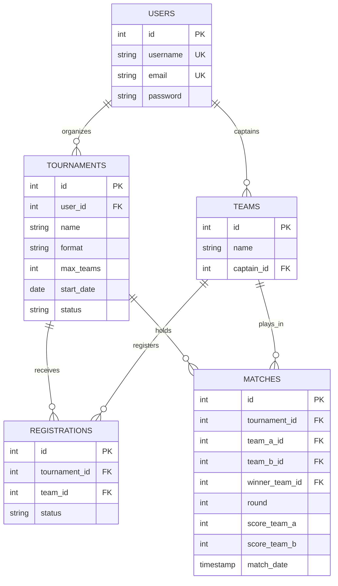

# Sistem Manajemen Turnamen Esports REST API

[](https://vercel.com)
[](https://python.org)
[](https://flask.palletsprojects.com/)
[-336791?logo=postgresql)](https://supabase.com)
[](test_api.py)

RESTful API backend untuk platform penyelenggaraan dan manajemen turnamen *esports*. Proyek ini dibangun menggunakan **Python Flask** dan **PostgreSQL (Supabase)**, serta siap di-deploy secara serverless ke **Vercel**.

---

## Fitur Utama

1. **CRUD Turnamen (`/api/tournaments`)**:
   - `GET /api/tournaments`: Mengambil daftar turnamen (mendukung pencarian `?search=` dan filter status `?status=open|ongoing|completed`).
   - `GET /api/tournaments/<id>`: Mengambil detail turnamen lengkap beserta daftar tim yang sudah terdaftar.
   - `POST /api/tournaments`: Membuat turnamen baru (validasi nama, format, dan kapasitas kuota tim).
   - `PUT /api/tournaments/<id>`: Memperbarui data turnamen (status, format, max_teams).
   - `DELETE /api/tournaments/<id>`: Menghapus turnamen (dilengkapi proteksi integritas: jika turnamen sudah memiliki pendaftaran tim aktif, mengembalikan status 409 Conflict).
2. **Master Data & Jadwal Pertandingan**:
   - `GET /api/teams`: Mengambil daftar tim esports beserta kaptennya.
   - `GET /api/matches`: Mengambil jadwal dan hasil pertandingan (tim A, tim B, skor, pemenang, dan tanggal tanding).
   - `GET /api/registrations`: Mengambil riwayat registrasi tim ke turnamen.
3. **Health Check & Monitoring**:
   - `GET /api/health`: Memeriksa uptime server dan konektivitas database.

---

## Diagram Relasi Basis Data (ERD)

Skema relasional 5 tabel utama yang didefinisikan pada `esports_db.sql`:



---

## Struktur Direktori Proyek

```text
BE-back-end-/
├── api/
│   ├── index.py              # Entrypoint Flask WSGI serverless Vercel
│   └── db.py                 # Koneksi PostgreSQL & fallback data mock
├── .env.example              # Template variabel lingkungan
├── .gitignore                # File yang diabaikan oleh Git
├── app.py                    # Runner lokal (python app.py)
├── esports_db.sql            # Skema DDL tabel database
├── postman_collection.json   # Koleksi pengujian Postman siap impor
├── README.md                 # Dokumentasi proyek
├── requirements.txt          # Library dependencies
├── seed.sql                  # Data awal dummy (T1, Fnatic, RRQ, PRX)
├── SUBMISSION.md             # Format teks pengumpulan tugas
├── test_api.py               # Automated unit tests (12 skenario)
└── vercel.json               # Konfigurasi routing serverless Vercel
```

---

## Panduan Menjalankan Secara Lokal

1. **Clone Repositori**:
   ```bash
   git clone https://github.com/jokergeron/BE-back-end-.git
   cd BE-back-end-
   ```

2. **Install Dependencies**:
   ```bash
   pip install -r requirements.txt
   ```

3. **Jalankan Aplikasi**:
   ```bash
   python app.py
   ```
   Aplikasi akan aktif di `http://127.0.0.1:5000`.

4. **Menjalankan Automated Tests**:
   ```bash
   python test_api.py
   ```

---

## Panduan Deployment ke Vercel

1. Buka [Vercel Dashboard](https://vercel.com) dan login dengan GitHub.
2. Klik **Add New...** -> **Project**.
3. Import repositori `BE-back-end-`.
4. (Opsional) Tambahkan Environment Variable:
   - Key: `DATABASE_URL`
   - Value: Connection string PostgreSQL dari Supabase Anda.
5. Klik **Deploy**.

---

## Daftar Endpoint REST API

| Method | Endpoint | Deskripsi | Status Code |
| :--- | :--- | :--- | :---: |
| `GET` | `/` | API root metadata & index rute | 200 |
| `GET` | `/api/health` | Status server & konektivitas database | 200 |
| `GET` | `/api/teams` | Mengambil semua tim esports | 200 |
| `GET` | `/api/matches` | Mengambil data jadwal pertandingan | 200 |
| `GET` | `/api/registrations` | Mengambil daftar registrasi turnamen | 200 |
| `GET` | `/api/tournaments` | Mengambil daftar turnamen (`?status=` / `?search=`) | 200 |
| `GET` | `/api/tournaments/<id>` | Mengambil detail turnamen beserta tim terdaftar | 200 / 404 |
| `POST` | `/api/tournaments` | Membuat turnamen baru | 201 / 400 |
| `PUT` | `/api/tournaments/<id>` | Memperbarui data turnamen | 200 / 404 |
| `DELETE` | `/api/tournaments/<id>` | Menghapus turnamen (proteksi pendaftaran tim) | 200 / 404 / 409 |

### Contoh Request Body `POST /api/tournaments`
```json
{
  "name": "Dota 2 The International 2026",
  "format": "Double Elimination",
  "max_teams": 16,
  "start_date": "2026-10-15",
  "user_id": 1
}
```

### Contoh Pengujian Endpoint dengan cURL
```bash
# 1. Cek status kesehatan server
curl -X GET https://YOUR-VERCEL-URL.vercel.app/api/health

# 2. Mengambil daftar turnamen
curl -X GET https://YOUR-VERCEL-URL.vercel.app/api/tournaments
```

---

## Pengujian Postman

File koleksi `postman_collection.json` sudah disediakan di root repositori:
1. Buka aplikasi Postman atau ekstensi Thunder Client di VS Code.
2. Klik tombol **Import** dan pilih file `postman_collection.json`.
3. Variabel `{{baseUrl}}` otomatis mengarah ke `http://127.0.0.1:5000` (atau sesuaikan dengan URL Vercel).
